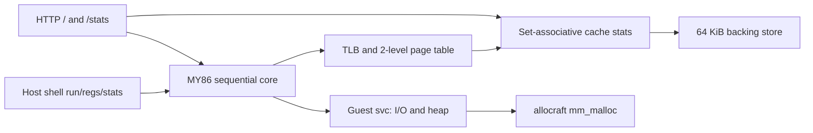

# capstone · 把第 1–12 章收成一台小机器

英文提要：`syscraft` is one process. A MY86 sequential core runs guest assembly. Every fetch and data access goes through a two-level page table and an 8-entry TLB, then a statistics cache, then a 64 KiB backing store. A tiny linker resolves `.global` symbols across modules. Guest `svc 3/4` allocate with the allocraft implicit-list allocator placed at guest address `0x8000`. A loopback HTTP thread serves `/stats` (JSON) and `/` (a one-page dashboard).



## 章节对应

| 章 | 在这台机器里的位置 |
| --- | --- |
| 1 漫游 | `make run` 从汇编源码走到进程里的一次 guest 执行 |
| 2 表示 | `regs` 把同一寄存器打成 hex / unsigned / signed / float 位模式 |
| 3 机器级 | guest 调用 `jal` / `jr`，链接器处理跨文件符号 |
| 4 体系结构 | `chapters/ch04_arch/my86.c` 就是这颗 CPU |
| 5 优化 | 顺序核 CPI 记为 1；流水线冒险在第 4 章的 `demo_pipe` 里测量 |
| 6 存储 | `memsys.c` 里的组相联 cache 统计每次取指和访存 |
| 7 链接 | `link.c`：本地标号加前缀，`.global` 全局只允许定义一次 |
| 8 异常 | `svc` 是陷入；宿主 shell 可以停掉这次运行（`quit`） |
| 9 虚拟内存 | 256 字节页、两级页表、全相联 TLB；堆用 allocraft |
| 10 I/O | `svc 1/2` 把 guest 输出写进缓冲，再由宿主打印 |
| 11 网络 | `127.0.0.1` 上的 HTTP/1.0 状态服务 |
| 12 并发 | 状态服务跑在独立线程里，和 CPU 循环同时存在 |

## 运行

```bash
make -C capstone run
```

`--demo` 会链接并运行三份程序（求和、两模块调用、guest malloc），再请求 `/` 和 `/stats`，成功时打印 `demo-ok`。

交互：

```bash
./capstone/syscraft
syscraft> run programs/sum.my
syscraft> regs
syscraft> stats
syscraft> quit
```

第一行 `status-port N` 是仪表盘端口。浏览器或 `curl 127.0.0.1:N/stats` 读取 JSON。
